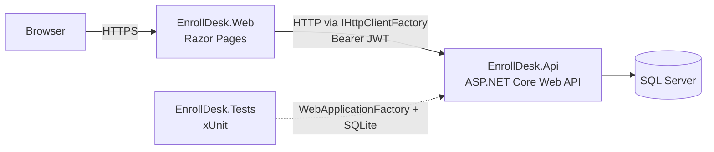

# EnrollDesk

[](https://github.com/edu-tech220/enrolldesk/actions/workflows/ci.yml)


A university course registration platform: students browse a term's course catalog, enroll into
sections, get waitlisted when a section is full, and drop or withdraw under a deadline policy.
Registrars manage the catalog and record final grades. Built as two independent ASP.NET Core 8
services — a Razor Pages frontend and a REST API — talking only over HTTP, the way a real
microservices split would.

## What it solves

Course registration looks like a simple CRUD app until two students try to grab the last seat in
a section at the same time, or a student tries to enroll in a course without having passed its
prerequisite. EnrollDesk's API encodes the rules that make registration *correct*, not just
functional:

- **No oversold sections.** Seat counts are guarded by an application-managed optimistic
  concurrency token, with automatic retry on conflict.
- **FIFO waitlists.** A full section waitlists new students in order; dropping a seat promotes
  the next person automatically and renumbers the remaining queue.
- **Prerequisite checks.** A student can't enroll in a course before passing (score ≥ 60) every
  course listed as its prerequisite.
- **Schedule conflict detection.** Two active enrollments in the same term can't meet on
  overlapping days and times.
- **Per-term credit caps.** A student's combined enrolled + waitlisted credit load can't exceed
  the term limit, unless a registrar explicitly overrides it.
- **Deadline-tiered drops.** Dropping before the add/drop deadline leaves no record; dropping
  after it but before the withdrawal deadline records a withdrawal; dropping after the withdrawal
  deadline is blocked for students (a registrar can still force it).

## Architecture

Two independently deployable ASP.NET Core 8 services, each with its own Dockerfile, sharing one
SQL Server instance. The frontend never touches the database directly — it only calls the API
over HTTP via a typed `HttpClient`.



- **EnrollDesk.Api** — the system of record. Owns the domain model, EF Core migrations, JWT
  issuing, and every business rule described above.
- **EnrollDesk.Web** — a thin Razor Pages client. Holds no business logic; it renders forms,
  calls the API, and keeps the signed-in user's JWT in an encrypted auth cookie so it can forward
  it as a Bearer token on every API call.
- **EnrollDesk.Tests** — exercises the rules engine directly (SQLite in-memory) and the full HTTP
  pipeline (`WebApplicationFactory`), so `dotnet test` never needs a real SQL Server.

## Technical decisions

- **Portable optimistic concurrency.** `Section.RowVersion` is a plain `int` incremented by the
  application and marked `IsConcurrencyToken()`, instead of a database-generated `rowversion`.
  The exact same entity and `DbContext` configuration work against SQL Server in production and
  SQLite in tests — no provider-specific concurrency tricks.
- **SQLite + `WebApplicationFactory` for tests.** Business-rule tests spin up an isolated
  in-memory SQLite database per test; HTTP endpoint tests boot the real ASP.NET Core pipeline
  against the same kind of database. Either way, `dotnet test` has zero external dependencies.
- **An injectable clock.** Every deadline rule reads time through `IClock` rather than
  `DateTime.UtcNow`, so tests can move "now" across add/drop and withdrawal deadlines
  deterministically instead of relying on sleeps or real wall-clock time.
- **Cookie-based JWT session on the frontend.** The Razor Pages app authenticates against the API
  like any other client, then stores the resulting JWT as a claim inside its own encrypted
  auth cookie. A `DelegatingHandler` reads that claim and attaches it as a Bearer token to every
  outgoing API call, so page code never handles the token directly.
- **RFC 7807 everywhere.** Every rule violation (prerequisite missing, schedule conflict, credit
  cap, stale concurrency token, past deadline) maps to a `ProblemDetails` response with a
  status code chosen by outcome, not a generic 400.

## Business rules reference

| Rule | Where it lives | Enforced by |
|---|---|---|
| No overselling a section | `EnrollmentService.EnrollAsync` | Optimistic concurrency retry loop on `Section.RowVersion` |
| FIFO waitlist + auto-promotion | `EnrollmentService.EnrollAsync` / `DropAsync` | `Section.WaitlistCount` + ordered `WaitlistPosition` |
| Prerequisites | `EnrollmentService.GetMissingPrerequisiteCodesAsync` | Completed enrollment with `FinalScore >= 60` |
| Schedule conflicts | `EnrollmentService.FindScheduleConflictAsync` | Day-flag intersection + time-range overlap |
| Per-term credit cap | `EnrollmentService.EnrollAsync` | Sum of active enrollments' credits vs. `Term.MaxCreditsPerTerm` |
| Add/drop vs. withdrawal tiers | `EnrollmentService.DropAsync` | `Term.AddDropDeadline` / `Term.WithdrawalDeadline` compared via `IClock` |
| Grading only after the term ends | `EnrollmentService.RecordGradeAsync` | `Term.EndDate` compared via `IClock` |

## API endpoints

| Method | Route | Auth | Notes |
|---|---|---|---|
| POST | `/api/auth/register` | Public (rate-limited) | Creates a Student account, returns a JWT |
| POST | `/api/auth/login` | Public (rate-limited) | Returns a JWT |
| GET | `/api/courses` | Public | Paginated catalog |
| GET | `/api/courses/{id}` | Public | |
| POST | `/api/courses` | Registrar | Create a course, optionally with prerequisites |
| GET | `/api/terms` | Public | |
| GET | `/api/terms/active` | Public | |
| POST | `/api/terms` | Registrar | |
| GET | `/api/sections?termId=&courseId=` | Public | Paginated |
| GET | `/api/sections/{id}` | Public | |
| POST | `/api/sections` | Registrar | |
| POST | `/api/enrollments` | Student | Enroll or get waitlisted |
| GET | `/api/enrollments/mine` | Student | Caller's own enrollments |
| GET | `/api/enrollments?sectionId=&status=` | Registrar | Paginated, filterable |
| POST | `/api/enrollments/{id}/drop` | Owner or Registrar | Deadline-tiered drop/withdraw; Registrar can force past the deadline |
| POST | `/api/enrollments/{id}/grade` | Registrar | Only after the term's end date |

## Running it

### With Docker Compose

```bash
docker compose up --build
```

- Web: http://localhost:5110
- API + Swagger: http://localhost:5170/swagger

### Locally with `dotnet run`

1. Start SQL Server (`docker compose up sqlserver` is the easiest way, or point
   `ConnectionStrings:DefaultConnection` in `EnrollDesk.Api/appsettings.json` at your own instance).
2. `dotnet run --project EnrollDesk.Api` — applies migrations and seeds demo data automatically,
   listening on `http://localhost:5170`.
3. `dotnet run --project EnrollDesk.Web` — already configured with `Api:BaseUrl` pointing at step 2,
   listening on `http://localhost:5110`.

### Demo accounts (seeded automatically)

| Role | Email | Password |
|---|---|---|
| Registrar | `admin@enrolldesk.edu` | `Admin#2026` |
| Student | `student@enrolldesk.edu` | `Student#2026` |

## Testing

```bash
dotnet test
```

No Docker, no SQL Server, no network calls — every test runs against an isolated SQLite
in-memory database, either directly against `EnrollmentService` or through the full HTTP pipeline
via `WebApplicationFactory`.

## Known trade-offs

- **Waitlist renumbering is a follow-up step, not part of the atomic seat transaction.** Freeing
  a seat and promoting the next waitlisted student are protected together by `Section.RowVersion`.
  Renumbering the *remaining* waitlist positions (closing the gap left by the promoted student)
  runs as a second, separate `SaveChanges` call right after. In the rare case another request
  reads a stale position in between, the next drop or enroll on that section corrects it — the
  queue is always consistent again within one more operation. This keeps the hot path (seat
  counts) simple to reason about instead of folding cosmetic renumbering into the same retry loop.
- **Grading is intentionally registrar-only and single-shot.** `RecordGradeAsync` moves an
  enrollment straight to `Completed`; there's no grade-revision workflow, since that's outside
  what this project set out to demonstrate.

## Project layout

```
EnrollDesk.Api/      ASP.NET Core Web API — domain model, EF Core, JWT auth, business rules
EnrollDesk.Web/      ASP.NET Core Razor Pages — calls the API via IHttpClientFactory
EnrollDesk.Tests/    xUnit — SQLite-backed unit and endpoint tests
```
